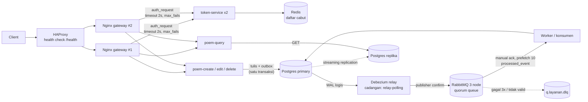

# Konfirmasi Titik Kritis dan Tanggapan Solusi (RASA / PuisiApp)

Dokumen ini menanggapi draf `perbaikan-reliability-puisiapp.md`. Setiap poin
dicocokkan dengan kode di branch `main` (commit 8ed9286, sudah termasuk merge
k7-auth dan k1-akun serta stack observability T0.8), compose lokal
`infra/docker-compose.yml` + `infra/compose/*.yml`, dan compose deploy
`infra/docker-compose.prod.yml`. Untuk daftar risiko lengkap lihat juga
[analisis-titik-kritis.md](analisis-titik-kritis.md).

Status yang dipakai:

- **Terkonfirmasi**: masalah memang ada di kode sekarang.
- **Sebagian**: masalahnya ada, tetapi penyebab atau bentuknya berbeda dari draf.
- **Sudah termitigasi**: solusi yang diusulkan draf sudah ada di kode.

## 1. Ringkasan

| No | Titik kritis (draf) | Status | Catatan singkat |
|----|---------------------|--------|-----------------|
| 1 | RabbitMQ & consumer worker | Sebagian | Durable, persistent, publisher confirm, manual ack, prefetch, retry + DLQ, dan idempotensi **sudah ada** di `libs/node` dan `libs/python`. Alert DLQ juga sudah ada di observability. Yang benar-benar tersisa: broker satu node, restart storm saat broker mati, alert belum dikirim ke mana pun, belum ada redrive, handler tanpa timeout |
| 2 | Jalur sinkron ke token-service | Terkonfirmasi, bentuknya berbeda | Verifikasi tidak dipanggil oleh layanan, tetapi oleh **Nginx `auth_request`**. Circuit breaker opossum hanya cocok untuk login-service → token-service. Di gateway, padanannya adalah timeout pendek, `max_fails`, dan 2 replika |
| 3 | Database | Terkonfirmasi | Satu klaster Postgres untuk semua database layanan, tanpa standby. Health check + `depends_on: service_healthy` **sudah ada**. Pemisahan baca/tulis secara logis sudah ada lewat CQRS (poem-query punya read model sendiri) |
| 4 | API Gateway Nginx | Terkonfirmasi | Satu instans, satu-satunya port ke host. `/health` dan `restart` sudah ada. Di compose prod gateway belum punya health check dan batas memori |
| - | Belum ada di draf | Terkonfirmasi | Redis satu instans (sesi, suara, SSE), outbox relay Debezium, rantai publikasi tanpa batas waktu, dan satu host EC2. Lihat bagian 6 |

## 2. Poin 1: Message broker & consumer worker

### 2.1 Konfirmasi

Sebagian besar masalah yang ditulis draf **sudah ditangani** oleh pustaka bersama:

| Usulan draf | Kondisi di proyek | Bukti |
|-------------|-------------------|-------|
| Queue durable | Quorum queue `durable: true` untuk `q.<layanan>` dan `q.<layanan>.dlq` | `libs/node/src/topologi.js` (`pastikanAntrean`) |
| Pesan persistent | `persistent: true` di setiap publish | `libs/node/src/publisher.js` (`opsiPesan`) |
| Publisher confirms | `createConfirmChannel()` + `publishDenganKonfirmasi` | `libs/node/src/publisher.js`, `libs/python/event_lib/konsumen.py:111` |
| Manual ack | `noAck: false`, ack setelah transaksi commit | `libs/node/src/konsumen.js`, `konsumen.py:153` (`auto_ack=False`) |
| Prefetch 10 | `BAWAAN.prefetch = 10`, bisa diubah lewat env `PREFETCH` | `libs/node/src/konsumen.js` |
| Retry terbatas | 3 kali, full jitter (≤2 dtk, ≤8 dtk, ≤32 dtk) lewat exchange `retry.delayed` | `libs/node/src/konsumen.js` (`tanganiPesan`) |
| DLQ | `dlx` → `q.<layanan>.dlq`. Pesan tidak valid dan `GalatPermanen` langsung ke DLQ | `topologi.js`, `konsumen.js` |
| Pesan yang membuat worker crash berulang | `x-delivery-limit: 5`, jadi pesan yang membunuh proses tetap berakhir di DLQ | `topologi.js` (`BATAS_PENGIRIMAN`) |
| Idempotency key | `event_id` (UUID v7 di amplop) dicatat di tabel `processed_event` **di transaksi yang sama** dengan handler. Ada juga penyaring event basi berdasarkan `aggregate_version` | `libs/node/sql/001_processed_event.sql`, `libs/node/src/store.js` |
| Producer tidak kehilangan event | Layanan tidak publish langsung. Event ditulis ke tabel outbox dalam transaksi bisnis, lalu dikirim Debezium (atau `relay-polling.js`) | `libs/node/src/outbox.js`, `infra/debezium/` |

Jadi pernyataan "dengan auto-ack pesan hilang saat consumer crash" **tidak berlaku**
untuk RASA. Masalah yang masih ada:

1. **RabbitMQ satu node** (`infra/docker-compose.yml`, service `rabbitmq`). Quorum queue
   dengan satu anggota tidak tereplikasi. Bila node mati, seluruh alur asinkron berhenti.
2. **Restart storm**. `libs/node/src/koneksi.js` memanggil `process.exit(1)` saat
   koneksi putus. Selama broker mati, semua layanan Node restart berulang.
3. **Pesan tertunda di plugin delayed-message tidak tereplikasi.** Retry memakai
   exchange `x-delayed-message`. Plugin ini menyimpan pesan yang sedang ditunda hanya
   di node tempat pesan diterima, jadi klaster pun tidak melindungi pesan yang sedang
   menunggu retry.
4. **DLQ sudah dipantau, tetapi belum ada notifikasi dan redrive.** Di `main` sudah ada
   alert `RabbitMQDLQNotEmpty` dan `RabbitMQQueueWithoutConsumer`
   (`infra/observability/prometheus_alerts.yml`, data dari `rabbitmq_exporter.py`).
   Namun receiver `default` di `alertmanager.yml` belum punya tujuan (email/webhook),
   stack observability dijalankan dari compose terpisah (`infra/observability/docker-compose.yml`),
   dan belum ada alat untuk memproses ulang isi DLQ.
5. **Handler tanpa timeout.** Handler yang menggantung menahan slot prefetch, koneksi
   pool, dan advisory lock agregat.

### 2.2 Tanggapan atas contoh kode draf

Contoh di draf tidak perlu dipakai karena justru lebih lemah dari yang sudah ada:

- Retry dikirim ulang ke `puisi.queue` **tanpa jeda**, sehingga pesan gagal diulang
  secepat mungkin (hot loop) dan tidak ada backoff.
- `channel.publish` di channel biasa lalu langsung `ack`. Bila publish gagal, pesan
  hilang. Proyek memakai publish dengan confirm, dan bila gagal pesan di-`nack` dengan
  requeue (`kembalikan`).
- `isProcessed` dicek **di luar** transaksi, jadi dua worker bisa lolos bersamaan.
  Proyek mencatat `processed_event` di dalam transaksi, dan primary key yang menolak duplikat.
- Nama `puisi.queue`, `messageId`, dan tabel `processed_messages` tidak ada di proyek.
  Konvensi yang dipakai: `q.<layanan>`, `event_id` di amplop, tabel `processed_event`.

### 2.3 Solusi versi proyek

1. **Klaster RabbitMQ 3 node** (`rabbitmq-1..3`, Erlang cookie sama, `cluster_formation`
   classic config). Quorum queue otomatis tereplikasi ke 3 node tanpa mengubah
   `topologi.js`.
   ```ini
   # infra/rabbitmq/rabbitmq.conf
   cluster_formation.peer_discovery_backend = classic_config
   cluster_formation.classic_config.nodes.1 = rabbit@rabbitmq-1
   cluster_formation.classic_config.nodes.2 = rabbit@rabbitmq-2
   cluster_formation.classic_config.nodes.3 = rabbit@rabbitmq-3
   ```
2. **Koneksi multi-host di `hubungkan()`**: baca `RABBITMQ_HOSTS=rabbitmq-1,rabbitmq-2,rabbitmq-3`
   dan coba bergiliran. Saat koneksi putus, sambung ulang ke node lain dulu sebelum
   memilih `process.exit(1)`, supaya tidak terjadi restart storm.
3. **Retry tanpa plugin delayed-message** (opsional, bila klaster dipakai): ganti
   `retry.delayed` dengan queue tunggu bertingkat (`q.<layanan>.retry.2s/8s/32s`)
   yang memakai `x-message-ttl` + dead-letter kembali ke queue asal. Queue tunggu
   ini quorum, jadi ikut tereplikasi.
4. **Lengkapi DLQ + redrive**: isi receiver Alertmanager (webhook/email) agar alert
   `RabbitMQDLQNotEmpty` yang sudah ada benar-benar sampai ke tim, lalu tambah skrip
   `libs/node/bin/redrive-dlq.js` yang memindahkan pesan dari `q.<layanan>.dlq` ke
   queue asal (reset header `x-percobaan`).
5. **Timeout handler** di `tanganiPesan`: bungkus `d.handler` dengan batas waktu
   (mis. env `HANDLER_TIMEOUT_MS`, bawaan 30 dtk). Bila lewat, lempar galat sementara
   sehingga masuk jalur retry yang sudah ada.

## 3. Poin 2: Jalur sinkron ke token-service

### 3.1 Konfirmasi

Masalahnya nyata, tetapi alurnya berbeda dari draf. Di RASA tidak ada layanan yang
memanggil `POST /verify` ke token-service. Alur yang sebenarnya:

```
Klien → Nginx (auth_request /_auth) → token-service GET /internal/auth/verify → Redis (daftar cabut)
login-service → token-service POST /internal/tokens   (menerbitkan token saat login)
```

Bukti:

- `infra/nginx/conf.d/gateway.conf`: `location = /_auth` tanpa `proxy_connect_timeout`
  dan `proxy_read_timeout`, jadi memakai bawaan 60 dtk. Cache hanya `200 30s`.
- `services/token-service/src/index.js`: verifikasi tanda tangan JWT (RS256, `jose`)
  lalu `daftarCabut.sudahDicabut(jti)` ke Redis di **setiap** request yang tidak kena cache.
- `infra/compose/identity.yml`: token-service satu replika.
- `services/login-service/src/index.js` (`mintaToken`): `fetch` dengan
  `AbortSignal.timeout(3000)`, tanpa retry dan tanpa breaker.

Dampak yang terkonfirmasi: bila token-service atau Redis lambat, koneksi tertahan
sampai 60 dtk dan menghabiskan `worker_connections 1024` gateway, sehingga rute
publik ikut terganggu. Bila token-service mati, `auth_request` membalas **500**,
bukan 503.

### 3.2 Tanggapan atas solusi draf

| Usulan draf | Tanggapan |
|-------------|-----------|
| Timeout 2 dtk | **Setuju**, dipasang di `/_auth` (Nginx), bukan di kode layanan |
| Circuit breaker opossum | **Hanya untuk login-service → token-service.** Nginx OSS tidak punya circuit breaker. Padanannya di gateway adalah `max_fails` + `fail_timeout` (breaker pasif) dan timeout pendek |
| Retry + backoff + jitter | Setuju untuk login-service (maks 2 kali, hanya timeout/5xx). **Tidak** untuk `auth_request`, karena retry di setiap request terlindungi justru memperbesar beban saat token-service lambat |
| Fail closed (503) | **Setuju.** Bila verifikasi gagal, request tidak boleh diloloskan. Kode status perlu diubah dari 500 ke 503 + `Retry-After` |
| Validasi JWT lokal (JWKS) | Sudah separuh jalan: token RS256 dan kunci publik sudah ada (`JWT_PUBLIC_KEY_PEM`). Tetapi daftar cabut di Redis tetap dibutuhkan agar logout/cabut berlaku ≤ 30 dtk. Jadi validasi lokal mengurangi beban, bukan menghapus ketergantungan |

### 3.3 Solusi versi proyek

1. **token-service 2 replika** (`deploy.replicas: 2` di `infra/compose/identity.yml`).
   Syarat: kunci JWT tetap dari `bash infra/jwt-keys.sh`. Tanpa itu setiap replika
   membuat kunci sementara sendiri dan token dari replika A ditolak replika B.
2. **Upstream dengan `resolve` + breaker pasif** (Nginx 1.28 mendukung `resolve` di
   upstream OSS, jadi tetap aman walau layanan belum ada saat gateway start):
   ```nginx
   # conf.d/gateway.conf (di luar blok server)
   upstream token_service {
       zone token_service 64k;
       server token-service:8080 resolve max_fails=3 fail_timeout=30s;
   }

   location = /_auth {
       internal;
       proxy_pass http://token_service/internal/auth/verify;
       proxy_connect_timeout 1s;
       proxy_read_timeout    2s;
       proxy_next_upstream   error timeout;
       proxy_next_upstream_tries 2;
       # ... header dan cache seperti sekarang
   }
   ```
   Catatan: dengan satu replika, Nginx mengabaikan `max_fails`. Breaker pasif baru
   bekerja setelah token-service minimal 2 replika (DNS Docker mengembalikan 2 IP).
3. **Fail closed dengan 503**: di rute terlindungi tambahkan
   `error_page 500 502 504 = @auth_down;` (tidak menangkap 500 dari layanan tujuan
   karena `proxy_intercept_errors` mati).
   ```nginx
   location @auth_down {
       default_type application/json;
       add_header Retry-After 10 always;
       return 503 '{"error":"auth_unavailable"}';
   }
   ```
4. **Opossum di login-service** untuk `mintaToken()` dengan parameter draf
   (timeout 2 dtk, 50% dari minimal 10 request, reset 30 dtk). Saat Open, login
   membalas 503.
5. **Redis di token-service diberi batas waktu**: klien `redis` saat ini mengantre
   perintah saat Redis putus. Pasang `disableOfflineQueue: true` dan timeout perintah
   agar verifikasi gagal cepat lalu jatuh ke 503.

## 4. Poin 3: Database

### 4.1 Konfirmasi

- **Terkonfirmasi**: satu service `postgres` untuk semua database layanan
  (`infra/docker-compose.yml`), tanpa standby dan tanpa failover.
- **Sudah termitigasi**: health check `pg_isready` dan `depends_on: { condition: service_healthy }`
  sudah dipakai di `infra/compose/poem.yml` dan `identity.yml`. Layanan tidak lagi
  menyala sebelum DB siap. Setelah start, `pg.Pool` membuat koneksi baru per query,
  jadi DB yang restart tidak memaksa layanan restart.
- **Sebagian**: batas pool baru ada di domain puisi dan vote (`connectionTimeoutMillis: 2000`,
  `statement_timeout: 5000`). login, register, profile, account-recovery, dan
  mood-feed masih `new pg.Pool({ connectionString, max: 10 })` tanpa timeout, dan
  belum punya handler `pool.on('error')`.
- **Berbeda dari draf**: tidak ada "Puisi Service" yang memisahkan baca/tulis di satu
  kode. Tulis dan baca sudah dipisah per layanan (CQRS): poem-create/edit/delete
  menulis, poem-query membaca read model sendiri yang diisi dari event.

### 4.2 Tanggapan atas solusi draf

| Usulan draf | Tanggapan |
|-------------|-----------|
| Retry koneksi dengan backoff saat startup | Sebagian besar tidak perlu karena `service_healthy` sudah ada. Cukup untuk layanan yang start tanpa `depends_on` |
| Pool dengan batas | **Setuju**, samakan semua layanan dengan pola domain puisi |
| Read replica | Setuju, dengan catatan: poem-query juga **menulis** (proyeksi dari event), jadi butuh dua pool: proyeksi ke primary, GET ke replika |
| Failover primary | Setuju sebagai prosedur promote manual (`pg_ctl promote`). Patroni terlalu berat untuk Learner Lab |
| Health check | Sudah ada |

### 4.3 Solusi versi proyek

1. **Samakan pool di semua layanan** (login, register, profile, account-recovery, mood-feed):
   ```js
   const pool = new pg.Pool({
     connectionString: process.env.DATABASE_URL,
     max: 10,
     connectionTimeoutMillis: 2000,
     statement_timeout: 5000,
   });
   pool.on('error', (err) => log.error('pool postgres galat', { err }));
   ```
2. **Standby streaming `postgres-replica`** (`pg_basebackup -R` dari primary,
   `hot_standby=on`). poem-query dan mood-feed membaca dari `DATABASE_REPLICA_URL`
   untuk GET. Lag replikasi tidak mengubah perilaku karena read model memang
   sudah eventual consistent.
3. **Prosedur failover manual** di `docs/runbook.md`: promote replika, arahkan
   `DATABASE_URL` ke replika, restart layanan tulis.
4. **Catatan penting untuk outbox relay**: replication slot logis Debezium **tidak
   ikut pindah** ke standby di PostgreSQL 16 (slot failover baru ada di PG 17). Setelah
   promote, slot harus dibuat ulang, dan karena `snapshot.mode=no_data` event di outbox
   yang belum terkirim tidak dibaca ulang. Mitigasinya: saat failover, jalankan
   `relay-polling.js` (sudah ada, aman multi-replika lewat `SKIP LOCKED`) sampai
   outbox kosong, baru nyalakan Debezium lagi.

## 5. Poin 4: API Gateway (Nginx)

### 5.1 Konfirmasi

- **Terkonfirmasi**: `api-gateway` satu instans dan satu-satunya layanan yang
  memetakan port ke host (`infra/docker-compose.yml`, `docker-compose.prod.yml`).
  `worker_connections 1024` (`infra/nginx/nginx.conf`) dan koneksi SSE status pemrosesan
  ikut memakai slot ini.
- **Sudah ada**: `location = /health` dan `location = /stub_status` untuk nginx-exporter
  (`conf.d/gateway.conf`), `restart: unless-stopped`, dan health check `wget` di compose lokal.
  Dengan 2 replika, `stub_status` perlu di-scrape per replika agar metrik tidak tercampur.
- **Belum ada**: health check dan batas memori untuk `api-gateway` di
  `docker-compose.prod.yml`. Timeout upstream umum (`proxy_connect_timeout`,
  `proxy_read_timeout`) juga belum ada.

### 5.2 Tanggapan atas solusi draf

| Usulan draf | Tanggapan |
|-------------|-----------|
| 2 replika active-active | **Setuju** |
| Load balancer + health check aktif | Setuju, HAProxy cocok |
| LB tidak boleh jadi SPOF | Benar secara konsep. Di satu host EC2, keepalived + VIP tidak menambah apa pun karena host-nya sendiri SPOF. Pilihan nyata: ALB bila Learner Lab mengizinkan, atau terima HAProxy sebagai SPOF yang jauh lebih sederhana dan stabil dari Nginx yang memuat banyak rute |
| `restart: always` | Sudah ada `unless-stopped`, setara untuk kebutuhan ini |
| `mem_limit` | Setuju, pakai `deploy.resources.limits.memory` seperti layanan lain |
| Upstream statis `puisi-service-1/2` | **Tidak cocok.** Gateway sengaja memakai variabel + `resolver 127.0.0.11` agar tetap start walau layanan belum ada. Upstream statis membuat Nginx gagal start bila satu nama tidak ter-resolve. Pakai upstream dengan parameter `resolve` (lihat 3.3) |

### 5.3 Solusi versi proyek

1. **Gateway 2 replika tanpa port host**:
   ```yaml
   api-gateway:
     # ... seperti sekarang, tetapi tanpa `ports:`
     deploy:
       replicas: 2
       resources:
         limits: { memory: 256M }
     healthcheck:
       test: ["CMD", "wget", "-qO-", "http://127.0.0.1/health"]
       interval: 5s
       timeout: 2s
       retries: 3

   load-balancer:
     image: haproxy:2.9-alpine
     restart: unless-stopped
     ports:
       - "${GATEWAY_BIND:-127.0.0.1}:${GATEWAY_HOST_PORT:-8080}:80"
     volumes:
       - ./haproxy/haproxy.cfg:/usr/local/etc/haproxy/haproxy.cfg:ro
     networks: [edge]
   ```
2. **HAProxy menemukan replika lewat DNS Docker**, jadi jumlah replika bisa diubah
   tanpa mengedit konfigurasi:
   ```
   resolvers docker
       nameserver dns 127.0.0.11:53
       hold valid 5s

   defaults
       mode http
       timeout connect 2s
       timeout client  60s
       timeout server  60s
       # SSE status pemrosesan: koneksi dibiarkan terbuka lama (ping 15 dtk)
       timeout tunnel  1h

   frontend http_in
       bind *:80
       default_backend gateways

   backend gateways
       balance roundrobin
       option httpchk GET /health
       server-template gw 2 api-gateway:80 check inter 3s fall 3 rise 2 resolvers docker init-addr none
   ```
3. **Timeout upstream umum** di `common/proxy-headers.conf`: `proxy_connect_timeout 2s`
   dan `proxy_read_timeout 15s`, kecuali rute SSE yang sudah mengatur sendiri.
   `proxy_next_upstream error timeout` hanya untuk GET (POST tidak boleh diulang
   otomatis karena bisa membuat puisi ganda, walaupun Idempotency-Key ada).
4. Naikkan `worker_connections` (mis. 4096) karena SSE memegang koneksi lama.

## 6. Titik kritis yang belum ada di draf

Ditemukan di kode dan perlu masuk laporan, minimal sebagai risiko yang diterima:

| Titik | Bukti | Dampak | Usulan |
|-------|-------|--------|--------|
| **Redis satu instans** | `infra/docker-compose.yml` (`redis`, `maxmemory 512mb`, `volatile-lru`) | Dipakai token-service (daftar cabut, refresh), vote-service, dan SSE. Redis mati = semua rute login gagal, suara ditolak, status langsung berhenti. Ini Kritis, setara poin 2 | Replika + Sentinel, atau minimal pisahkan Redis sesi dari Redis suara dan pakai `noeviction` untuk sesi |
| **Outbox relay Debezium** | `infra/debezium/relay.yml`, `application.properties` (`snapshot.mode=no_data`), `max_slot_wal_keep_size=1024MB` | Relay mati lama → slot di-invalidate → event dalam rentang itu hilang permanen | Pantau lag slot, alert, cadangan `relay-polling.js` |
| **Rantai publikasi tanpa batas waktu** | `services/publication-service/src/mesin.js`, `services/similarity-worker/src/app/main.py` | Worker kemiripan macet → puisi tertahan di `PROCESSING` selamanya. `/health` similarity-worker tetap `ok` karena berjalan di thread terpisah | Batas waktu `PROCESSING` (mis. tahan ke moderasi setelah N menit), health check yang memeriksa thread konsumen |
| **Layanan API kritis satu replika** | `infra/compose/poem.yml`, `identity.yml` (hanya status-stream `replicas: 2`) | Crash/OOM = fitur mati sampai container sehat lagi | 2 replika untuk poem-create, poem-query, token-service |
| **Satu host EC2 Learner Lab** | `docker-compose.prod.yml` | Host mati = semua replika ikut mati | Di luar cakupan. Dicatat sebagai batasan |

## 7. Koreksi diagram arsitektur

Diagram draf perlu disesuaikan agar sesuai sistem:

- "Puisi Service" sebenarnya beberapa layanan: poem-create, poem-edit, poem-delete
  (tulis), poem-query (baca), publication-service, notification-service.
- Token-service dipanggil oleh **gateway** (`auth_request`), bukan oleh Puisi Service.
- Event tidak di-publish langsung oleh layanan, tetapi lewat **outbox → Debezium → `outbox.relay`**.
- Redis perlu digambar karena menjadi dependensi auth.



## 8. Koreksi skenario pengujian

Nama container mengikuti `docker compose ps`. Hasil yang diharapkan dibedakan antara
kondisi sekarang dan setelah perbaikan, supaya demo bisa menunjukkan perbedaannya.

| Skenario | Cara uji | Sekarang | Setelah perbaikan |
|----------|----------|----------|-------------------|
| Consumer crash saat memproses | `docker compose kill publication-service` saat puisi diajukan | Sudah lolos: pesan belum di-ack kembali ke queue, diproses setelah restart, tanpa duplikat (`processed_event`) | Sama |
| Poison message | Publish JSON rusak ke exchange `poem.events` lewat Management UI | Sudah lolos: langsung ke `q.<layanan>.dlq`, worker tetap hidup, alert `RabbitMQDLQNotEmpty` menyala di Prometheus | Alert terkirim ke tim, pesan bisa di-redrive |
| Broker mati | `docker compose stop rabbitmq` | Alur asinkron berhenti, layanan Node restart berulang | Satu node mati, quorum queue tetap jalan di 2 node lain |
| Token-service mati | `docker compose stop token-service`, lalu kirim request ke `/api/poems` | Token yang baru di-cache masih lolos ≤ 30 dtk, sisanya **500** setelah menunggu | Replika lain melayani. Bila semua mati, **503** dalam ≤ 2 dtk, rute publik tetap responsif |
| Redis mati | `docker compose stop redis` | Rute login gagal, suara ditolak | 503 cepat (fail closed), tidak menggantung |
| Primary DB mati | `docker compose stop postgres` | Semua layanan berbasis Postgres gagal | GET daftar puisi tetap jalan via replika. Tulis kembali setelah promote |
| Gateway mati | `docker stop <proyek>-api-gateway-1` | Aplikasi tidak bisa diakses | HAProxy menandai replika down dalam ~9 dtk, trafik ke replika 2, replika 1 restart otomatis |

## 9. Prioritas usulan

Urutan berdasarkan dampak dan biaya, mengikuti syarat minimal 3 titik:

1. **Jalur auth (poin 2 + Redis)**: timeout `/_auth`, 503 fail closed, token-service 2
   replika, timeout Redis. Perubahan kecil, dampak paling besar, mudah didemokan.
2. **Gateway (poin 4)**: 2 replika + HAProxy. Konfigurasi saja, tanpa ubah kode layanan.
3. **Broker (poin 1)**: klaster RabbitMQ 3 node + koneksi multi-host. Pemantauan DLQ
   dan timeout handler sebagai tambahan.
4. **Data (poin 3)**: samakan timeout pool dulu (murah). Replika Postgres dan
   prosedur failover bila waktu cukup, dengan catatan slot Debezium.
