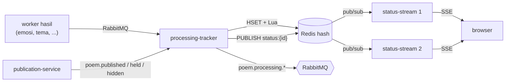

# processing-status (T2.7)

Status pemrosesan puisi secara langsung: penulis melihat langkah emosi, tema, kata kunci, gambar, pemeriksaan keaslian, dan jejak keaslian tercentang satu per satu, tanpa refresh. Satu image, dua entrypoint (seperti `image-service`).

| Entrypoint | Peran |
| --- | --- |
| `processing-tracker` (`src/tracker.js`) | Worker `q.processing-tracker`. Mencatat langkah per versi di Redis, menerbitkan `poem.processing.updated` / `poem.processing.completed`, dan mengumumkan snapshot ke Redis pub/sub |
| `status-stream-service` (`src/stream.js`) | `GET /api/poems/{id}/status/stream` (SSE), hanya pemilik. Kontrak: [`contracts/openapi/poem-status-stream.yaml`](../../contracts/openapi/poem-status-stream.yaml). Berjalan 2 replika |



## Langkah dan event

| Langkah (`stage`) | Event selesai |
| --- | --- |
| `emotion` | `poem.emotion.analyzed` |
| `themes` | `poem.themes.extracted` |
| `keywords` | `poem.keywords.extracted` |
| `image` | `poem.image.rendered` |
| `similarity` | `poem.similarity.scored` |
| `authorship` | `authorship.recorded` |

Langkah aktif diatur `PROCESSING_LANGKAH` (bawaan semua). Keluarkan langkah yang workernya belum ada (misalnya `authorship` di tahap Demo) supaya status bisa mencapai COMPLETED.

- `poem.processing.updated` terbit untuk setiap langkah, dengan `status` PROCESSING (versi 1) atau REPROCESSING (revisi).
- `poem.processing.completed` terbit saat semua langkah versi itu selesai.
- Keduanya memakai `event_id` deterministik, jadi pengiriman ulang aman.

## Keadaan di Redis

| Kunci | Isi |
| --- | --- |
| `proses:{poem_id}` | `author_id`, `versi` (terbaru), `publikasi`, `publikasi_at`, `diubah_at` |
| `proses:{poem_id}:v{n}` | `mulai_at`, `l:<langkah>` (waktu selesai), `selesai_at` |
| kanal `status:{poem_id}` | snapshot JSON setiap perubahan |

Semua kunci ber-TTL 7 hari (`STATUS_TTL_DETIK`) dan ditulis lewat skrip Lua, sehingga aman walau tracker lebih dari satu replika. Hasil worker yang tiba sebelum `poem.submitted` tetap tercatat; pemiliknya menyusul.

## SSE

- Saat tersambung, layanan berlangganan kanal dulu, baru membaca snapshot, supaya tidak ada perubahan yang terlewat; pesan yang lebih lama dari yang sudah dikirim dibuang.
- Koneksi yang terputus disambung ulang otomatis oleh EventSource (`retry: 3000`) dan langsung mendapat snapshot terkini, ke replika mana pun.
- Bila stream dibuka tepat setelah POST 202, layanan menunggu sampai 5 detik sampai tracker mencatat pemilik.
- Gateway (`routes/poem.conf`) mematikan buffering, dan `proxy_read_timeout` diatur 1 jam; layanan mengirim `: ping` tiap 15 detik.
- Frontend: komponen `StatusPemrosesan` di `PuisiDiproses` (halaman detail setelah mengirim puisi).

## Pengujian

```bash
TEST_REDIS_URL=redis://:redis_dev_only@localhost:6379 npm test
```

Tanpa `TEST_REDIS_URL`, hanya uji logika dan kontrak yang berjalan. Uji dengan Redis mencakup dua replika SSE, sambung ulang, hak akses, dan kebocoran langganan.

Uji integrasi lewat gateway dengan layanan asli (poem-create, image-render-worker, publication-service):

```bash
GATEWAY_URL=http://localhost:8080 node scripts/uji-integrasi.js
```
